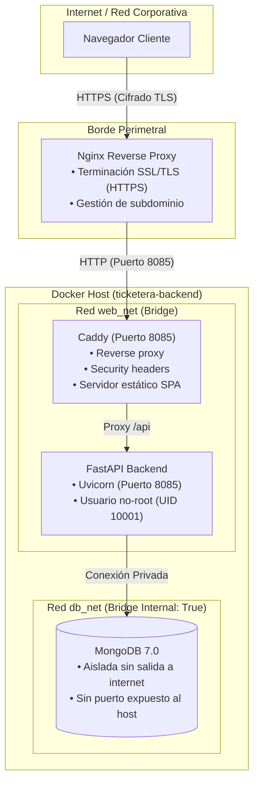

# 🛡️ Guía y Especificación de Seguridad - TicketCoopya

Este documento detalla todas las políticas, configuraciones de hardening y mecanismos de defensa implementados en la infraestructura y el código fuente del sistema de tickets.

---

## 🏗️ 1. Arquitectura Perimetral y de Red

El sistema opera bajo un esquema de defensa en capas con separación de responsabilidades:



---

## 🌐 2. Hardening de Caddy (`Caddyfile`)

Caddy actúa como la primera línea de defensa interna para el backend y el frontend:

| Directiva | Ubicación | Función de Seguridad |
| :--- | :--- | :--- |
| **`-Server`** | `header { -Server }` | Elimina la cabecera identificatoria del servidor web para evitar el fingerprinting de versiones. |
| **`X-Content-Type-Options`** | `"nosniff"` | Impide que los navegadores interpreten archivos con tipos MIME distintos a los declarados. |
| **`X-Frame-Options`** | `"DENY"` | Bloquea totalmente la inclusión del sitio dentro de `<iframe>` o `<frame>`, neutralizando ataques de Clickjacking. |
| **`Referrer-Policy`** | `"strict-origin-when-cross-origin"` | Evita la fuga de URLs y parámetros internos hacia servicios de terceros en la cabecera `Referer`. |
| **`Permissions-Policy`** | `"camera=(), microphone=(), geolocation=()"` | Restringe el acceso a APIs de hardware sensibles del navegador. |
| **`request_body`** | `max_size 10MB` | Limita el tamaño de las peticiones entrantes a 10MB para prevenir desbordamientos de memoria y ataques DoS. |
| **Bloqueo de Ocultos** | `@hidden path */.* -> 404` | Retorna error 404 automático ante intentos de solicitar archivos como `.env`, `.git`, `.htaccess`, etc. |
| **Bloqueo Swagger / Docs** | `@docs path /docs* /redoc* /openapi.json -> 404` | Bloquea por completo el acceso a la documentación OpenAPI interactiva en entornos de producción. |
| **Proxy Inverso Explícito** | `@backend path /api* /health*` | Solo canaliza hacia FastAPI las rutas de API y verificación de salud; todo lo demás es contenido estático SPA. |

---

## 🐳 3. Hardening de Contenedores (`docker-compose.yml` & `Dockerfile`)

La infraestructura de contenedores cumple con los 6 estándares de hardening recomendados:

1. **Prevención de escalada de privilegios (`no-new-privileges:true`)**:
   - Activo en `caddy`, `backend` y `mongodb`. Impide que los binarios dentro del contenedor obtengan privilegios adicionales mediante `setuid`/`setgid`.
2. **Ejecución como usuario sin privilegios (Non-Root)**:
   - El backend corre bajo el usuario de sistema `appuser` (UID `10001`, GID `10001`) con shell `/sbin/nologin`.
3. **Límites de recursos (CPU y Memoria)**:
   - `caddy`: 0.50 CPU, 256 MB RAM.
   - `backend`: 1.00 CPU, 768 MB RAM.
   - `mongodb`: 1.00 CPU, 1024 MB RAM.
   - *Garantiza que un proceso con fuga o consumo elevado no desestabilice el sistema anfitrión.*
4. **Rotación y límites de logs (`logging`)**:
   - Todos los servicios utilizan el driver `json-file` con `max-size: "10m"` y `max-file: "3"`, impidiendo el llenado accidental del disco por logs.
5. **Aislamiento de redes (`networks`)**:
   - `web_net`: Conecta Caddy con Backend para resolver peticiones web.
   - `db_net`: Red con directiva `internal: true`. Conecta exclusivamente el Backend con MongoDB. MongoDB **no** posee puertos publicados en el host ni visibilidad desde Caddy ni desde el exterior.
6. **Volúmenes en solo lectura (`:ro`)**:
   - El archivo `./Caddyfile` se monta en `/etc/caddy/Caddyfile:ro`.
   - La carpeta compilada `./dist` se monta en `/srv:ro`.
7. **Healthchecks activos y encadenamiento seguro**:
   - `mongodb`: Ejecuta `mongosh --eval "db.adminCommand('ping')"` cada 5s.
   - `backend`: Depende de `mongodb` con `condition: service_healthy`.
   - `caddy`: Depende de `backend` con `condition: service_healthy` y verifica su salud cada 30s.

---

## 🔐 4. Autenticación, Sesiones y Cuenta Maestra

### Cuenta Maestra de Administrador
* **Email**: `admin@sistemas.com` (configurable vía variable `MASTER_ADMIN_EMAIL` en `.env`).
* **Contraseña**: Hasheada con algoritmo **bcrypt** (salt criptográfico + 12 rondas de costo).
* **Auto-Seed**: En cada arranque, la función `seed_default_admin()` asegura la existencia y activación de la cuenta.

### Tokens JWT
* **Algoritmo**: `HS256`.
* **Expiración**: **24 horas exactas** (`ACCESS_TOKEN_EXPIRE_MINUTES = 1440`).
* **Canales admitidos**:
  - Encabezado estándar `Authorization: Bearer <token>` para todas las llamadas REST.
  - Parámetro query `?token=<token>` para la conexión de eventos en tiempo real SSE (`/api/v1/tickets/stream`).

---

## 🛡️ 5. Control de Acceso por Roles (RBAC)

Se implementó el modelo de **Portal de Mesa de Ayuda Abierto + Dashboard Administrativo Privado**:

| Recurso / Endpoint | Método | Acceso | Nivel de Control |
| :--- | :---: | :---: | :--- |
| `/crearticket-usuario` | Frontend | **Público** | Vista para carga rápida de solicitudes por parte de empleados. |
| `POST /api/v1/tickets/` | API | **Público Blindado** | Protegido con Honeypot invisible + Rate Limit por IP y por correo. |
| `/` (Tablero Kanban) | Frontend | **Privado** | Requiere inicio de sesión en `/login` (`ProtectedRoute`). |
| `GET /api/v1/tickets/` | API | **Operador / Admin** | Requiere Bearer Token JWT. |
| `GET /api/v1/tickets/stream` | API | **Operador / Admin** | Requiere Bearer Token JWT o `?token=...`. |
| `PATCH /api/v1/tickets/{id}` | API | **Operador / Admin** | Edición y movimiento de columnas restringido a usuarios autenticados. |
| `POST /api/v1/tickets/{id}/bloquear` | API | **Operador / Admin** | Control de concurrencia y candado exclusivo de edición. |
| `DELETE /api/v1/tickets/{id}` | API | **Exclusivo Admin** | Solo cuentas con `rol == 'admin'` pueden borrar tickets. |
| `DELETE /api/v1/tickets/{id}/images/{fid}` | API | **Exclusivo Admin** | Solo administradores pueden purgar adjuntos de GridFS. |
| `/api/v1/tickets/{id}/comments` | API | **Operador / Admin** | Lectura y adición de comentarios auditada por usuario. |
| `DELETE /comments/{cid}` | API | **Exclusivo Admin** | Eliminación de comentarios restringida a administradores. |

---

## 🤖 6. Rate Limiting y Protección Anti-Bot

Para mantener el formulario de tickets público sin comprometer el servicio, operan 4 capas de filtrado:

1. **Campo Trampa Anti-Bot (Honeypot)**:
   - Se inyecta un campo invisible `hp_company_field` con `opacity: 0; pointer-events: none; tabIndex: -1`.
   - Los usuarios humanos no lo completan; los scripts y crawlers automáticos lo rellenan.
   - Si el campo contiene cualquier dato, la API rechaza la petición con código `400 Bad Request`.
2. **Rate Limiting por IP (En Memoria)**:
   - Máximo **5 tickets cada 10 minutos por dirección IP**.
   - Si se supera el umbral, el servidor responde con el tiempo restante que el cliente debe aguardar.
3. **Cuota Diaria por Correo**:
   - Máximo **8 tickets diarios** por dirección de correo electrónico en una ventana de 24 horas.
   - Periodo de enfriamiento (*cooldown*) de **60 segundos** entre envíos sucesivos del mismo solicitante.
   - *Los correos listados en `ADMIN_EMAILS` están exentos de cuotas y cooldown.*
4. **Sanitización de Contenido (Anti-XSS)**:
   - Los campos de texto libre (`titulo` y `descripcion`) neutralizan caracteres de etiquetas HTML (`<` y `>`) antes de persistir en base de datos.

---

## 📁 7. Restricciones en Carga de Archivos (GridFS)

En el servicio de subida (`GridFSService`) se aplican validaciones estrictas:

* **Formatos de Imagen Permitidos**: PNG, JPEG, JPG, WebP, GIF, AVIF, BMP, SVG (`image/*`).
* **Formatos de Documento Permitidos**: PDF (`application/pdf`), planillas Excel (`.xlsx`, `.xls`), archivos de datos (`.csv`), texto plano (`.txt`).
* **Tamaño Máximo Backend**: 25 MB por archivo.
* **Tope en Servidor Web (Caddy)**: 10 MB para todo el cuerpo de la petición.

---

## ⚙️ 8. Variables de Entorno Requeridas (`.env`)

```env
# Base de Datos MongoDB
MONGO_URI=mongodb://mongodb:27017/tickets_db
MONGO_DB_NAME=tickets_db

# Orígenes CORS permitidos
BACKEND_CORS_ORIGINS=["http://localhost:3000", "http://localhost:5173", "http://localhost:8000", "http://localhost:8085"]

# Seguridad y Cuotas por Correo
MAX_DAILY_TICKETS_PER_EMAIL=8
TICKET_CREATION_COOLDOWN_SECONDS=60

# Lista blanca de administradores (exentos de cooldown)
ADMIN_EMAILS=["nmonticoopya@gmail.com", "nfernandezcoopya@gmail.com", "fbernard@coopya.com.ar", "admin@sistemas.com"]

# Cuenta Maestra de Administrador
MASTER_ADMIN_EMAIL=admin@sistemas.com
MASTER_ADMIN_PASSWORD=admin123
```
